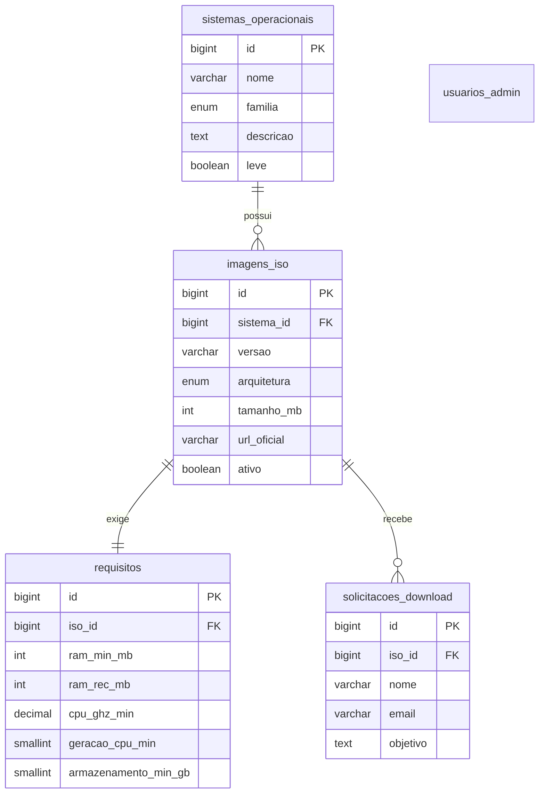

# Biblioteca Archive

Trabalho de Conclusão de Curso (Engenharia de Software, Centro Universitário ENIAC):
**Desenvolvimento e criação da biblioteca de imagens ISO para reutilização de dispositivos antigos.**

Plataforma web que organiza imagens ISO de sistemas operacionais e ajuda pessoas sem conhecimento
técnico a escolher um sistema compatível com o seu computador, estendendo a vida útil de equipamentos
e reduzindo o descarte de lixo eletrônico.

## Funcionalidades

| Funcionalidade | Onde |
|---|---|
| Biblioteca de ISOs com busca por nome, família e arquitetura | `public/index.html` |
| Busca por hardware (RAM, processador, geração) que recomenda ISOs compatíveis | `public/buscar.html` |
| Formulário antes do download; o link oficial só é liberado depois | `public/download.html` |
| Assistente de IA consultivo que recomenda ISOs do banco | `public/assistente.html` |
| Painel administrativo (login e cadastro, edição e exclusão de ISOs) | `admin/` |

## Tecnologias

- **Front-end:** HTML, CSS e JavaScript puro (sem frameworks)
- **Back-end:** PHP 8 puro, com PDO e prepared statements
- **Banco de dados:** MySQL / MariaDB
- **Ambiente:** XAMPP
- **IA:** Google Gemini (camada gratuita) ou Anthropic Claude, chamados somente pelo PHP

## Estrutura de pastas

```text
admin/      Painel administrativo (PHP renderizado no servidor)
api/        Endpoints JSON consumidos pelo front-end
config/     Leitura do .env e conexão com o banco
database/   schema.sql, seed.sql, scripts de apoio e documentação do banco
public/     Páginas, CSS, JavaScript e imagens
```

## Como executar

1. Instale o [XAMPP](https://www.apachefriends.org/) e inicie o **Apache** e o **MySQL**.
2. Coloque o projeto em `htdocs/Biblioteca-Archieve`.
3. Importe `database/schema.sql` e depois `database/seed.sql` pelo phpMyAdmin.
4. Copie `config/.env.example` para `config/.env` e ajuste as credenciais do banco.
5. Acesse `http://localhost/Biblioteca-Archieve/public/index.html`.

Detalhes do banco, do painel administrativo e do chatbot estão em [database/README.md](database/README.md).

## Modelo de dados



## API

Todas as respostas seguem o formato `{ "sucesso": true, "dados": ..., "erro": null }`.

| Método | Endpoint | Descrição |
|---|---|---|
| GET | `api/isos.php` | Lista ISOs ativas (filtros: `busca`, `familia`, `versao`, `arquitetura`, `leve`) |
| GET | `api/iso.php?id=N` | Dados e requisitos de uma ISO |
| GET | `api/familias.php` | Famílias e versões disponíveis para os filtros |
| GET | `api/recomendar.php` | ISOs compatíveis com o hardware (`ram_mb`, `ghz`, `geracao`, `modelo`) |
| POST | `api/solicitar_download.php` | Registra o formulário e devolve o link oficial |
| POST | `api/chat.php` | Conversa com o assistente de IA |

## Segurança

- Todo SQL usa prepared statements; toda saída HTML é escapada.
- Chaves de API e senhas ficam apenas em `config/.env` (fora do Git), lidas pelo PHP.
- Painel administrativo com senha em hash (`password_hash`), token anti-CSRF e cookie de sessão `HttpOnly`.
- A URL de download não é exposta nas consultas públicas; só é devolvida após o formulário.

## Limitações

- Não há link oficial público para Windows XP, 7 e 8 nem para o macOS; esses itens aparecem como "Link indisponível".
- A camada gratuita do Gemini tem limite de uso; por isso o chat limita cada visitante a 30 perguntas por hora.
- O projeto é voltado a portfólio acadêmico e não está configurado para produção (hospedagem, HTTPS e manutenção).
